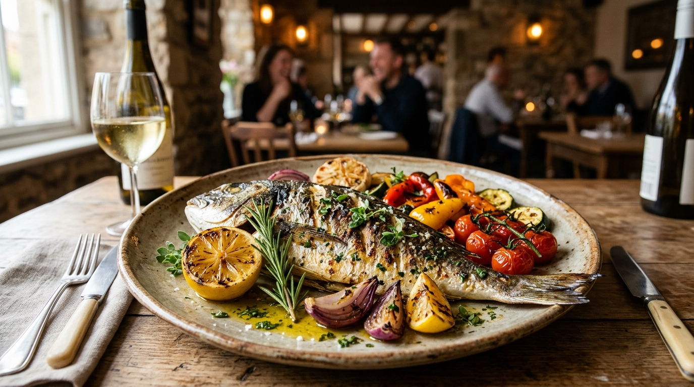

# Little Lemon Restaurant — Table Booking Web Application



A modern, responsive, accessible React web application for **Little Lemon**, a Mediterranean family-owned restaurant located in Chicago. Developed for the **Coursera Meta Front-End Developer Professional Certificate Capstone Project**.

---

## 📋 Table of Contents

- [Project Overview](#project-overview)
- [Key Features](#key-features)
- [Design & UI/UX](#design--uiux)
- [Accessibility (a11y)](#accessibility-a11y)
- [Technical Architecture](#technical-architecture)
- [API Integration & State Management](#api-integration--state-management)
- [Directory Structure](#directory-structure)
- [Getting Started](#getting-started)
  - [Prerequisites](#prerequisites)
  - [Installation](#installation)
  - [Running the Development Server](#running-the-development-server)
  - [Running Automated Unit Tests](#running-automated-unit-tests)
  - [Building for Production](#building-for-production)
- [Unit Testing Suite](#unit-testing-suite)
- [Coursera Peer-Review Rubric Verification](#coursera-peer-review-rubric-verification)
- [Known Limitations & Disclaimers](#known-limitations--disclaimers)
- [License & Acknowledgments](#license--acknowledgments)

---

## 🌟 Project Overview

Little Lemon is a family-owned Mediterranean restaurant focused on traditional recipes served with a modern twist. This web application provides an intuitive online table reservation experience for customers, alongside an authentic Mediterranean brand presence featuring chef highlights, customer testimonials, and weekly menu specials.

---

## ✨ Key Features

1. **Interactive Table Booking Form**:
   - Customer Full Name and Email validation.
   - Optional contact Phone Number validation.
   - Date picker with past-date prohibition (minimum date is always today).
   - Dynamic time-slot calculation via `fetchAPI(date)` that recalculates available slots upon date change.
   - Guest count selector (1 to 10 guests) with inline validation.
   - Occasion selector (*Casual Dining, Birthday, Anniversary, Engagement, Business Meal*).
   - Interactive seating preference selector (*Main Dining Room, Garden Patio, Chef's Counter*).
   - Optional special dietary requests and notes.
2. **Instant Booking Confirmation**:
   - Comprehensive summary display including guest name, date, time, party size, occasion, and seating area.
   - Generated unique demonstration reservation reference ID (e.g., `LL-DEMO-XXXXX`).
   - "Book Another Table" reset button to seamlessly book additional tables.
3. **Weekly Menu Specials**:
   - Authentic dishes: Greek Salad, Bruschetta, and Lemon Dessert.
   - High-resolution imagery, pricing, descriptions, and interactive delivery order preview.
4. **Restaurant Story**:
   - The culinary journey of founders Mario and Adrian in Chicago.
5. **Customer Social Proof**:
   - Testimonials and verified diner reviews with star ratings.

---

## 🎨 Design & UI/UX

The visual identity is inspired by the Mediterranean coast and the official Little Lemon design specifications:

- **Primary Colors**:
  - Mediterranean Olive Green: `#495E57`
  - Primary Lemon Yellow: `#F4CE14`
- **Secondary & Accent Colors**:
  - Warm Peach: `#EE9972`
  - Desert Sand / Cream: `#FBDABB`
  - Neutral Charcoal: `#333333`
  - Warm Surface Off-White: `#FDFBF7`
- **Typography**:
  - Headings: `Markazi Text` (Georgia serif fallback)
  - Body & UI: `Karla` (system-ui fallback)
- **Responsive Layout**:
  - Fully fluid design catering from mobile screens (320px+) to tablets and ultra-wide desktops without horizontal overflow.

---

## ♿ Accessibility (a11y)

Built from the ground up adhering to **WCAG 2.1 AA** standards:

- **Semantic HTML5**: Native landmarks (`<header>`, `<nav>`, `<main>`, `<section>`, `<article>`, `<footer>`).
- **Form Controls & Labels**: Every input, select, and textarea is explicitly bound to a visible `<label>` via matching `id` and `for` / `htmlFor` attributes (e.g., `res-date`, `res-time`, `guests`, `occasion`).
- **Accessible Validation & Feedback**:
  - `aria-required="true"` on mandatory form fields.
  - `aria-invalid` dynamically toggled based on validation state.
  - `aria-describedby` links inputs to their respective inline error messages.
  - Live regions (`role="alert"` and `aria-live="polite"`) for real-time announcements.
- **Keyboard Navigation**:
  - Skip-to-content link (`.skip-link`) allows keyboard users to bypass navigation.
  - High-visibility focus indicators (`:focus-visible`) across all interactive elements.
  - Autofocus shift to first invalid input upon form rejection.
- **Images**: All informative images include descriptive `alt` text; decorative icons include `aria-hidden="true"`.
- **Contrast**: Text contrast ratios meet or exceed 4.5:1 for standard text and 3:1 for large text.

---

## 🏗 Technical Architecture

- **Frontend Framework**: React 19 (Functional Components & Hooks).
- **Bundler & Dev Server**: Vite 8.
- **Testing Framework**: Vitest + React Testing Library (RTL) + `@testing-library/jest-dom` + `jsdom`.
- **Styling**: Vanilla CSS3 Custom Properties (Design Tokens), Flexbox, CSS Grid.

---

## 🔌 API Integration & State Management

The application adheres directly to the Coursera Meta Front-End Capstone specification:

### 1. `availableTimes` State & Reducer
Managed in [App.jsx](src/App.jsx) via `useReducer`:
```javascript
const [availableTimes, dispatchTimes] = useReducer(updateTimes, undefined, initializeTimes);
```
- `initializeTimes()`: Calls `fetchAPI(new Date())` to seed the initial time slots for today.
- `updateTimes(state, action)`: Dispatches `{ type: 'UPDATE_TIMES', payload: selectedDate }` when the user selects a new date, invoking `fetchAPI(selectedDate)` to provide date-specific availability.

### 2. `fetchAPI` & `submitAPI`
Implemented in [src/utils/bookingApi.js](src/utils/bookingApi.js):
- Uses deterministic pseudo-random distribution matching the official Meta Front-End Capstone algorithm.
- Checks for `window.fetchAPI` and `window.submitAPI` if injected by an external test environment, seamlessly falling back to the local implementation.
- `submitAPI(formData)` simulates saving the reservation locally to `localStorage` and returns `true`.

---

## 📂 Directory Structure

```text
Little_Lemon_Restaurant_Table_Booking_WebApp/
├── public/
│   └── images/
│       ├── hero.jpg
│       ├── greek-salad.jpg
│       ├── bruschetta.jpg
│       ├── lemon-dessert.jpg
│       └── mario-and-adrian.jpg
├── src/
│   ├── components/
│   │   ├── Header.jsx              # Responsive header & accessible navigation
│   │   ├── Hero.jsx                # Brand hero banner with CTA button
│   │   ├── MenuHighlights.jsx      # Specials cards & delivery order preview
│   │   ├── About.jsx               # Restaurant background & Mario/Adrian story
│   │   ├── Testimonials.jsx        # Customer reviews and ratings
│   │   ├── BookingForm.jsx         # Accessible table reservation form
│   │   ├── BookingConfirmation.jsx # Detailed reservation summary card
│   │   └── Footer.jsx              # Brand info, hours, links & disclaimer
│   ├── utils/
│   │   ├── bookingApi.js           # fetchAPI & submitAPI implementation
│   │   └── bookingUtils.js         # Reducer, validation logic, date helpers
│   ├── tests/
│   │   ├── bookingUtils.test.js    # Unit tests for reducer, api & validation
│   │   ├── BookingForm.test.jsx    # Unit tests for BookingForm component
│   │   └── App.test.jsx            # Full end-to-end integration tests
│   ├── setupTests.js               # Jest-DOM matchers configuration
│   ├── index.css                   # Global design tokens and styles
│   ├── App.jsx                     # Root component with state management
│   └── main.jsx                    # React entrypoint
├── index.html                      # HTML5 template with Google Fonts & metadata
├── package.json                    # Project dependencies and test scripts
├── vite.config.js                  # Vite & Vitest configuration
└── README.md                       # Complete documentation
```

---

## 🚀 Getting Started

### Prerequisites

Ensure you have **Node.js** (v18 or higher) and **npm** installed:
```bash
node -v
npm -v
```

### Installation

Clone the repository and install all dependencies:
```bash
git clone <YOUR-GITHUB-REPO-URL>
cd Little_Lemon_Restaurant_Table_Booking_WebApp
npm install
```

### Running the Development Server

Start the local Vite development server:
```bash
npm run dev
```
Open your browser and navigate to:
```text
http://localhost:5173/
```

### Running Automated Unit Tests

Run the full automated test suite:
```bash
npm run test
```
To run tests in interactive watch mode:
```bash
npm run test:watch
```

### Building for Production

Compile optimized production assets into the `dist/` directory:
```bash
npm run build
```
To preview the production build locally:
```bash
npm run preview
```

---

## 🧪 Unit Testing Suite

The project includes **23 automated tests** across 3 test suites:

| Test File | Coverage / Tested Behaviors |
| :--- | :--- |
| **`bookingUtils.test.js`** | `initializeTimes` non-empty slots, `updateTimes` reducer date changes, deterministic `fetchAPI`, `submitAPI` validation, `validateBookingForm` edge cases (email regex, past dates, guest limits 1–10), date formatting helpers. |
| **`BookingForm.test.jsx`** | All required form labels rendered, HTML5 validation attributes (`res-date`, `res-time`, `guests`, `occasion`), `dispatchTimes` called on date change, inline error messages on invalid submit, submit button disabled while submitting. |
| **`App.test.jsx`** | End-to-end rendering of all page landmarks, complete table reservation flow (filling form, submitting, displaying confirmation summary), and resetting form via "Book Another Table". |

---

## 📑 Coursera Peer-Review Rubric Verification

| Rubric Criterion | Implementation Verification |
| :--- | :--- |
| **1. UI/UX Design** | High-fidelity Mediterranean color scheme, typography (`Markazi Text` + `Karla`), professional restaurant photography, and smooth interactions. |
| **2. Semantic Elements** | Valid HTML5 landmarks: `<header>`, `<nav>`, `<main>`, `<section>`, `<article>`, `<footer>`, `<form>`. |
| **3. Booking Form Fields** | Name, Email, Phone, Date (`#res-date`), Time (`#res-time`), Guests (`#guests`), Occasion (`#occasion`), Seating preferences, Special requests. |
| **4. Available Times Reducer** | `useReducer` with `initializeTimes` and `updateTimes` dynamically tied to `fetchAPI(date)`. |
| **5. Form Validation** | Client-side validation prevents empty submits, validates email format, blocks past dates, and enforces guest limits (1–10). |
| **6. Confirmation Display** | Shows complete reservation summary with guest name, date, time, guests, occasion, and demo reference ID. |
| **7. Reset Option** | "Book Another Table" button resets the state cleanly and allows making subsequent reservations. |
| **8. Accessibility** | Fully labelled inputs (`htmlFor`), `aria-required`, `aria-invalid`, `aria-describedby`, visible focus rings, and skip link. |
| **9. Unit Tests** | Automated test suite verifying reducer, API, form validation, and component flows. |
| **10. Git & README** | Clean repository structure, detailed documentation, and setup instructions. |

---

## ⚠️ Known Limitations & Disclaimers

- **Frontend Demonstration**: This application is a frontend demonstration capstone project. Submitted table reservations are stored locally in the browser (`localStorage`) and do not connect to a live restaurant database or payment gateway.
- **Course API**: The API utility implements the deterministic algorithm provided in the Meta Front-End Capstone.

---

## 📄 License & Acknowledgments

- Built as part of the **Meta Front-End Developer Professional Certificate** on Coursera.
- Inspired by the Little Lemon brand assets provided by Coursera and Meta.
